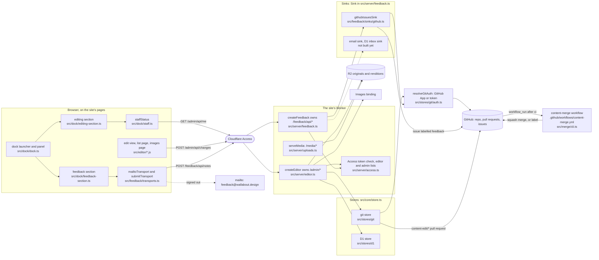
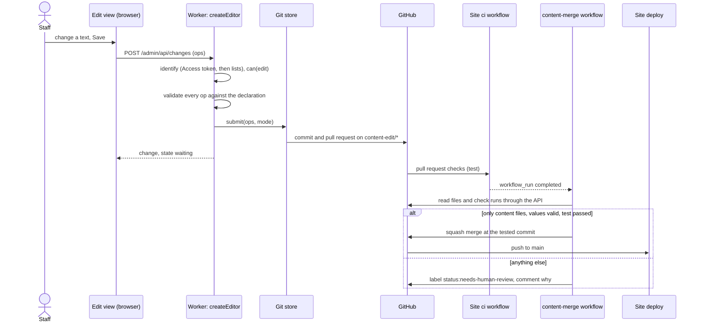
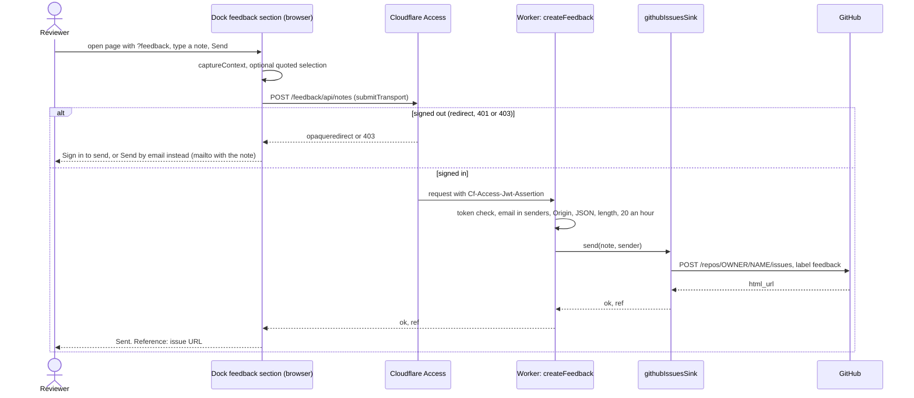
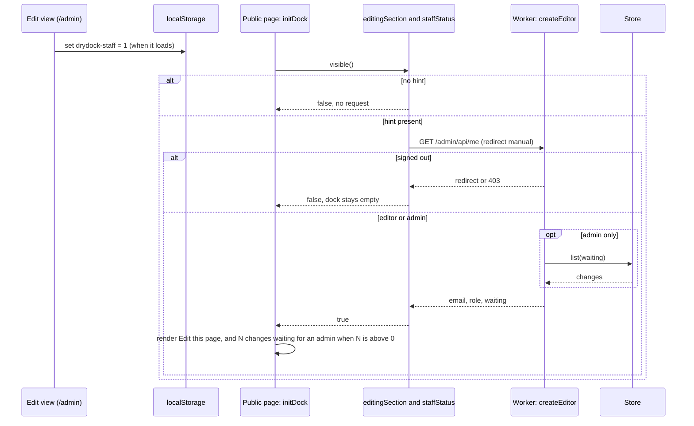

# Architecture

How `@wallabout-design/drydock` fits together, as the code does it today. The plan is `standards/drydock.md` in `wallabout-design/standards`. Paths are relative to this repo.

## The pieces

Entry points (`package.json` `exports`):

| Entry point | What | Side |
| --- | --- | --- |
| `.` | `defineContent`, reading content, the change model, the in-memory store | build and server |
| `./server` | `createEditor`, `createFeedback`, `identify`, `serveMedia`, `githubIssuesSink`; re-exports both stores until 1.0 | Worker |
| `./stores/git`, `./stores/d1` | One store each | Worker |
| `./react`, `./astro`, `./astro/*.astro` | Rendering texts, lists and images | pages |
| `./dock`, `./dock/react`, `./dock.css` | The launcher and panel, with `feedbackSection` and `editingSection` | public pages |
| `./feedback`, `./feedback/react`, `./feedback/reserve.css` | Capture, transports and the hidden link; imports nothing from the rest of the package | public pages |
| `./editor.js`, `./item-form.js`, `./editor.css` | The edit view's files, which `createEditor` also serves under `/admin` | `/admin` |
| `./testing` | `storeContract`, `sinkContract` | tests |

Not built: `emailSink` and `d1InboxSink` (named in the design). Images are handled in drydock: originals go to R2 and sizes are made by the `IMAGES` binding, only on a staff save (`src/server/uploads.ts`, `src/core/image.ts`).

## Flow a: a staff edit goes live

1. The edit view (`src/editor/editor.js`) posts the operations to `POST /admin/api/changes`; `createEditor` (`src/server/editor.ts`) calls `identify` and `can(identity, 'edit')` (`src/server/access.ts`), then validates the operations (`src/core/validate.ts`).
2. `gitStore.submit` (`src/stores/git/store.ts`) rebuilds the editor's branch `content-edit/<name>-<hash>/<date>` as the base branch plus one commit, and opens or updates one pull request (`src/stores/git/save.ts`). GitHub credentials come from `resolveGitAuth`.
3. In `review` mode the pull request carries `content:waiting-review` and an admin approves it on `/admin/changes` (`store.approve` merges it). The D1 store (`src/stores/d1/store.ts`) skips steps 2 to 4: a change is live at once.
4. In `auto` mode the site's `ci` workflow runs, then the site's `content-merge.yml` calls the reusable `.github/workflows/content-merge.yml`, which runs `dist/merge/cli.js` (`src/merge/cli.ts`, `src/merge/decide.ts`) from the default branch. It never checks out the pull request.
5. It squash-merges the tested commit only if every changed file is a content file, every value passes the declaration, and `test` passed; otherwise it labels `status:needs-human-review` and comments.
6. The deploy after the merge is the site's own, outside this repo. The store reports the change `live` once it sees the merge.

## Flow b: a reviewer's note becomes an issue

1. `?feedback` turns the section on (`src/feedback/optin.ts`, `localStorage`); `feedbackSection({ submit: submitTransport() })` shows the note box (`src/dock/feedback-section.ts`, `src/feedback/transports.ts`).
2. `captureContext` adds URL, viewport, build and the quoted selection (`src/feedback/capture.ts`).
3. `createFeedback({ siteId, sink, senders })` answers only `POST /feedback/api/notes` (`src/server/feedback.ts`). It checks the Access token with `accessEmail`, and the email against `senders`. A refusal is an empty 403.
4. It then checks `Origin`, JSON, 16 KB, 5,000 characters, and 20 notes an hour for each sender (`memoryLimiter`, in the Worker's memory unless the site passes its own).
5. The subject is `[<siteId>] <path> #<code>`. `githubIssuesSink` (`src/feedback/sinks/github.ts`) uses it as the issue title, labels it `feedback`, and leaves the sender's address out of the body.
6. Signed out, the note stays in the box and the mailto link carries a copy (`src/feedback/mailto.ts`).

## Flow c: the dock shows "Edit this page"

1. The edit view sets the hint (`src/editor/editor.js`, key `drydock-staff`, `src/dock/staff.ts`). It is not a permission.
2. `initDock` (`src/dock/dock.ts`) asks each section `visible()`; sections show in the order feedback, then editing; with none visible the root stays empty.
3. `staffStatus` makes the one request, only with the hint. `GET /admin/api/me` counts waiting changes for admins and reports 0 for editors (`src/server/editor.ts`).
4. `editingSection` links to `/admin/edit?page=<path>` and, for an admin with changes waiting, to `/admin/changes` (`src/dock/editing-section.ts`). The server decides what each link may do.
